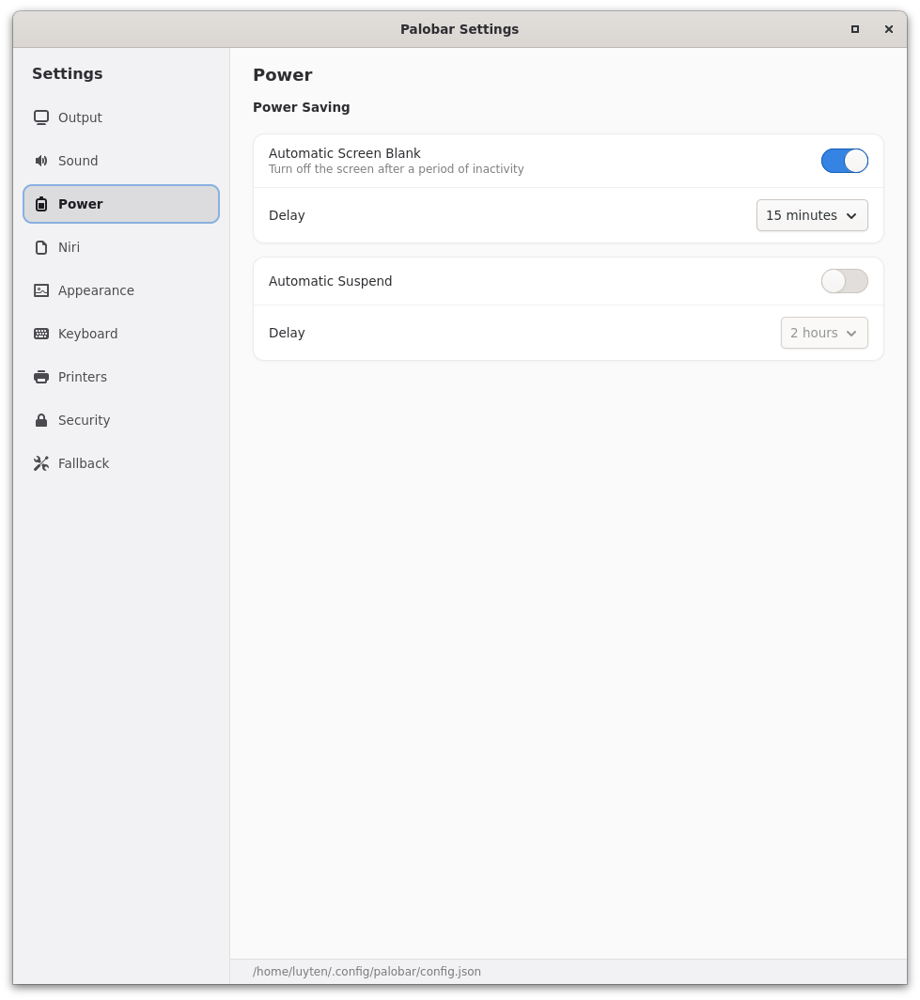
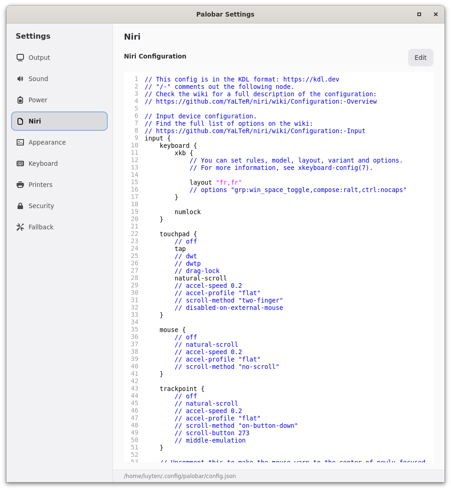
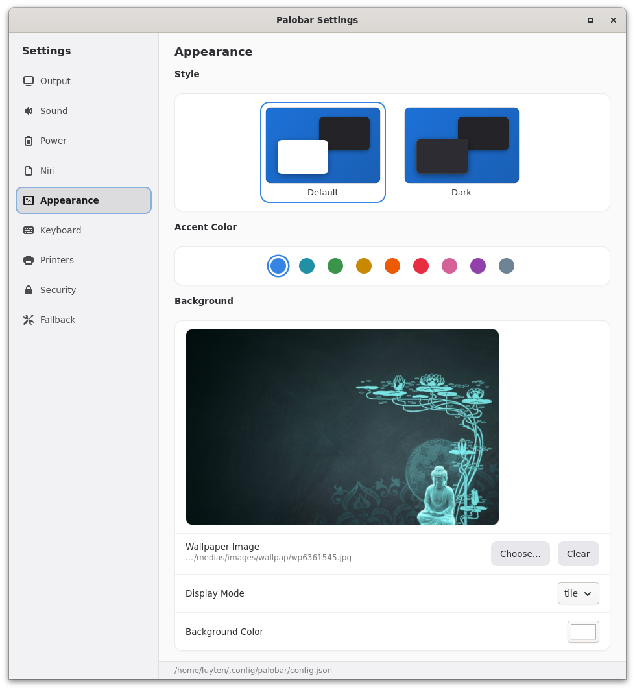

palobar is a cheap clone of GNOME visual style for niri

I am copying top bar & quick settings. While in niri overview mode, typing triggers the launcher

And will gradually do some prefs

Settings

Settings imitate gnome-control-center

The goal is to achieve a cheap clone and be close visually. But it is not intended to reproduce full setups. For example printers is mostly a link to cups web if you activated it.

The code is typescript and depends on ags astal. Project is too young to describe installation which is only fine with nix atm.

# Features

* `palobar` imitates gnome-panel + launcher
* `palobar-ctl toggle-launcher` to activate launcher independantly from overwiew
* `palobar-prefs` imitates gnome-control-center
* `palobar-run-command` will use niri spawn-sh to run anything.
    This includes running `palobar` since you do not need it to run.
* `palobar-ctl quit` is mostly useful for me

See [TODO](TODO.md).

## Active settings

palobar will apply settings from palobar-prefs which are stored in $CONFIG.json
- favoriteApp for launcher dock
- appearance = dark or light theme & accent color
- wallpaper
- lockscreen (picture, autoLock)
- power settings (blanck, suspend)

## Niri overview

Like GNOME, when niri triggers overview

* a search entry appears
* a dock appears, allows to click on app
* if user types, apps appear.

# Notes

If you click on the workspaces button in the top bar, niri might move the cursor. You may prevent this if you uncomment this in you `config.kdl`

    // warp-mouse-to-focus

