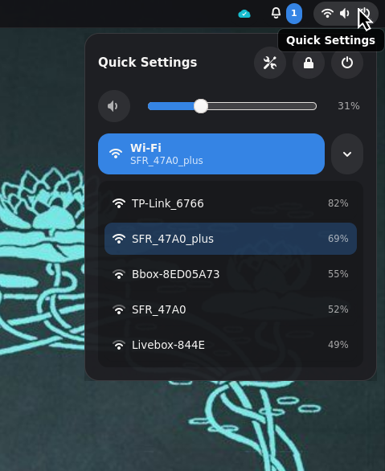

palobar is a cheap clone of GNOME visual style for niri

I am copying top bar

and partly its components

while in niri overview mode, typing triggers the launcher

and will gradually do some prefs

It is typescript and depends on ags astal.

* `palobar` to run
* `palobar-prefs`
* `palobar-ctl quit`
* `palobar-ctl toggle-launcher`

| component | palobar |
| - | - |
| top bar | ok + systray |
| top bar right panel | missing btooth & various |
| dock | nope, but not sure i want ? |
| overview launcher | OK done |

| gnome-settings | palobar |
| - | - |
| wifi | todo |
| network | todo |
| bluetooth | todo |
| screens | NA? or alternative niri stuff? |
| sound | todo |
| energy | todo |
| multi task | NA |
| appearance | todo |
| notifi | todo |
| research | todo |
| accounts | todo |
| share | todo |
| wellbeing | todo |
| mouse | todo |
| keyb | todo |
| colors | todo |
| printers | todo |
| accessibilty | todo |
| private | todo |
| system | todo |

