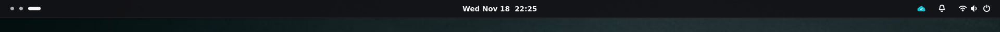
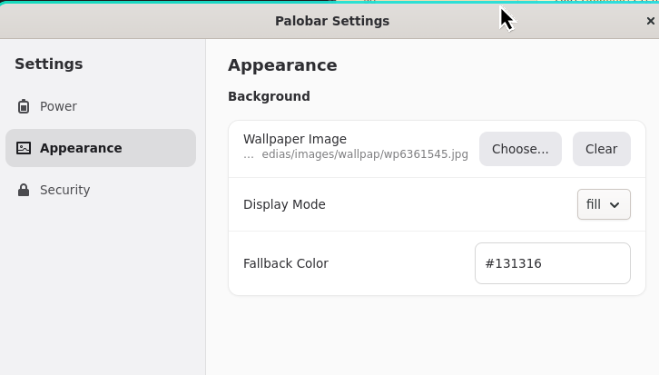

palobar is a cheap clone of GNOME visual style for niri

I am copying top bar

and partly its components

while in niri overview mode, typing triggers the launcher

and will gradually do some prefs

It is typescript and depends on ags astal.
The project is too young to describe installation which is likely a mess.

# Features

* `palobar` imitates gnome-panel + launcher
* `palobar-ctl toggle-launcher` to activate launcher independantly from overwiew
* `palobar-prefs` imitates gnome-control-center
* `palobar-run-command` will use niri spawn-sh to run anything. Include palobar.
* `palobar-ctl quit` is mostly useful for me

See [TODO](TODO.md) for things i may add.

## Niri overview

Like GNOME, when niri triggers overview

* a search entry appears
* a dock appears, allows to click on app
* if user types, apps appear.

# Notes

If you click on the workspaces button in the top bar, niri might move the cursor. You may prevent this if you uncomment this in you `config.kdl`

    // warp-mouse-to-focus

