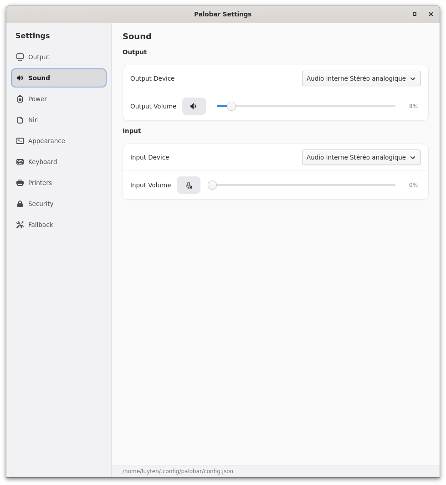
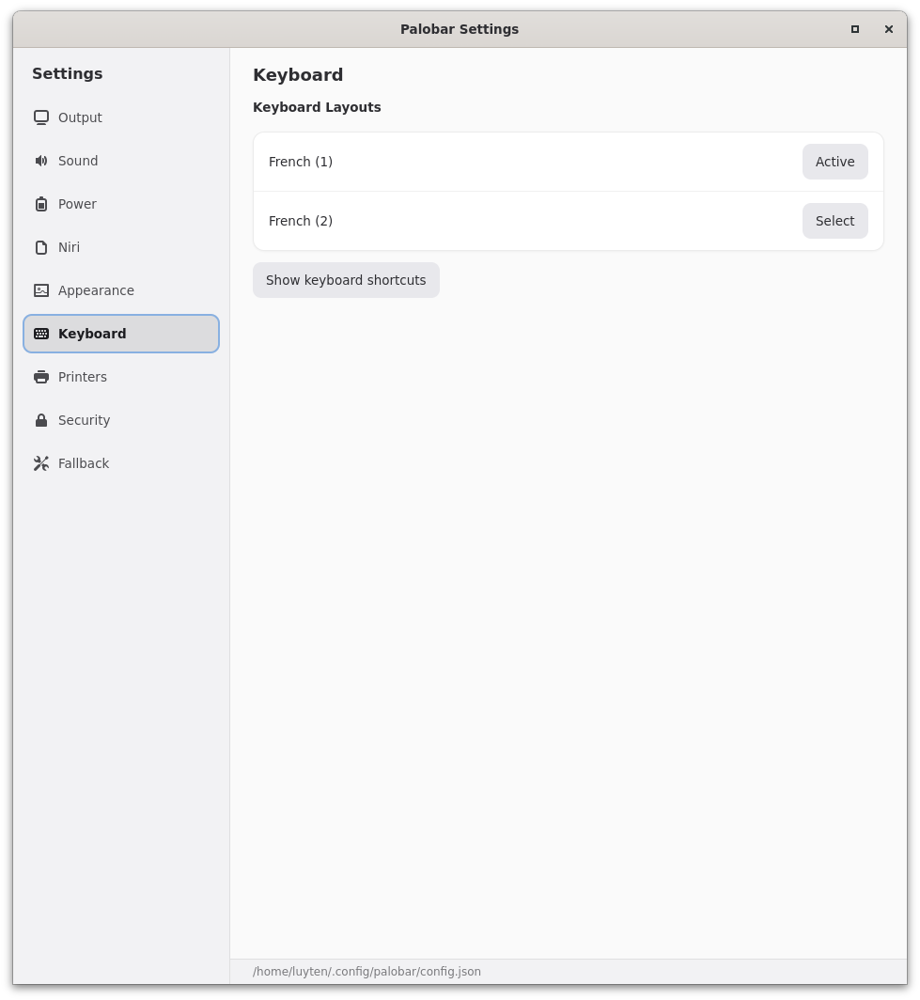
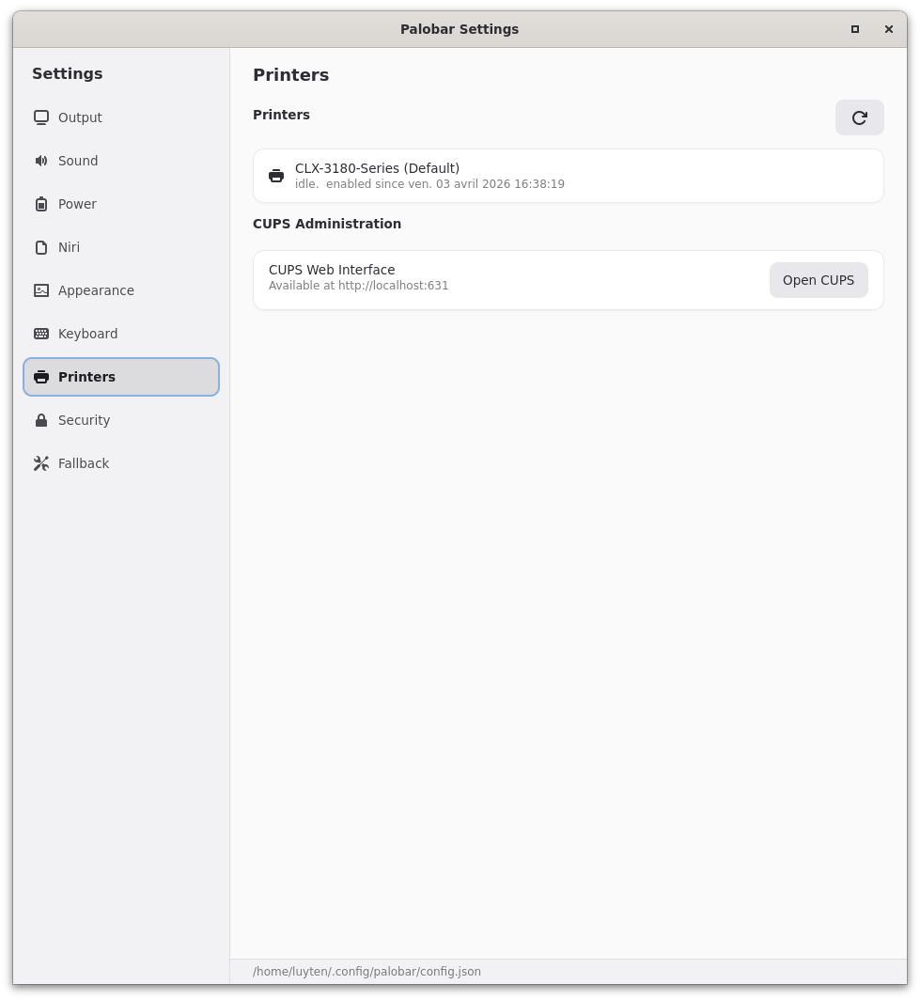
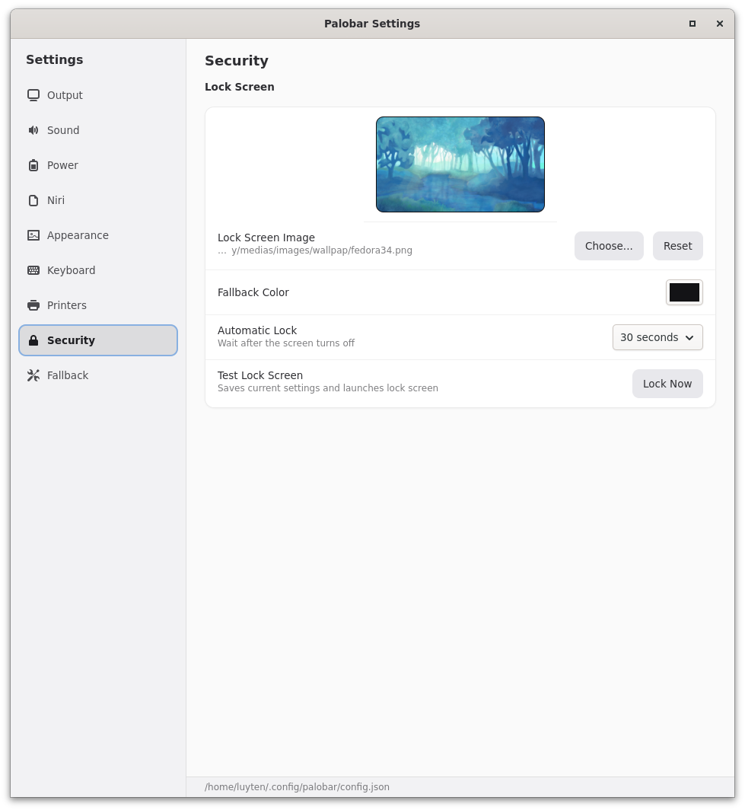

palobar is a cheap clone of GNOME visual style for niri

I am copying top bar & quick settings.

While in niri overview mode, typing triggers the launcher

* a search entry appears
* a dock appears, allows to click on app
* if user types, apps appear.

Settings

Settings imitate gnome-control-center
The goal is to achieve a cheap clone and be close visually. But it is not intended to reproduce full setups. For example printers is mostly a link to cups web if you activated it.

+ a json will write what is only used by palobar , 
    + wallpaper setup,
    + lockscreen setup,
    + favourite apps (pinned to dock)
+ gsettings write what is shared by gtk
    + color scheme
    + accent color
+ no amendment to niri config. However niri allows to temporarilly adjust a monitor.
  This is not written.

# Principles

The code is typescript and depends on ags astal. I thought I would use gjs for a mockup but it seems to be a reasonnable choice and may stick to it. Project is too young to describe installation which is only fine with nix atm.

Components are:
* `palobar` imitates gnome-panel + launcher
* `palobar-ctl toggle-launcher` to activate launcher independantly from overwiew
* `palobar-prefs` imitates gnome-control-center
* `palobar-run-command` will use niri spawn-sh to run anything.
    This includes running `palobar` since you do not need it to run.
* `palobar-ctl quit` is mostly useful for me

See [TODO](TODO.md).

# Notes

If you click on the workspaces button in the top bar, niri might move the cursor. You may prevent this if you uncomment this in you `config.kdl`

    // warp-mouse-to-focus

