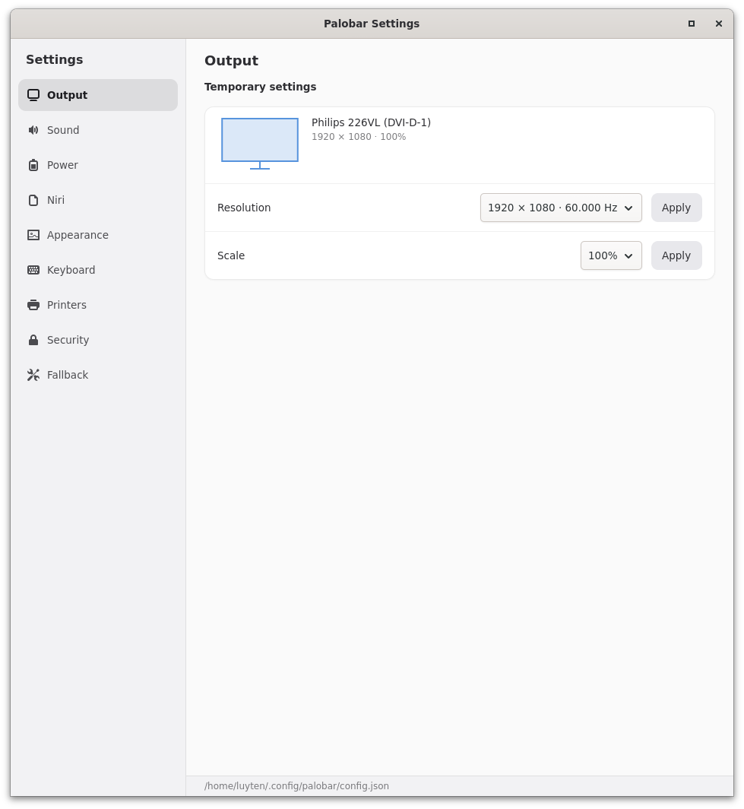

palobar is a cheap clone of GNOME visual style for niri, and a niri-control-center.

I am copying top bar & quick settings.


While in niri overview mode, typing triggers the launcher

* a search entry appears
* a dock appears, allows to click on app
* if user types, apps appear.


<details>
<summary>Settings</summary>

Settings imitate gnome-control-center but do not depend on GNOME tech and let you leverage existing config UI when there is. The goal is to achieve a cheap clone and be close visually. But it is not intended to reproduce full setups. For example printers is mostly a link to cups web if you activated it. Input sources is a link to fcitx/ibus. So you get all config accessible from a single place but it stays compatible with distros and services.




+ a json will write what is only used by palobar , 
    + wallpaper setup,
    + lockscreen setup,
    + favourite apps (pinned to dock)
+ gsettings write what is shared by gtk
    + color scheme
    + accent color
+ no amendment to niri config but live config + kdl shown
    + live config outputs
    + live config mouse theme
    + switch keyboard layout


</details>

# Build & Usage

The code is now rust and mainly depends on gtk & gtk-layer-shell.

Runtime integrations are optional. Report it as a bug if some missing command makes palobar fail or if palobar fails to report a missing component.

- `niri`
- `swaybg`
- `swayidle` and system PAM library is required for lock screen
- `wl-clipboard`, `cliphist`
- `NetworkManager` (`nmcli`)
- PipeWire/WirePlumber (`wpctl`)
- `systemctl`
- CUPS (`lpstat`)


## Niri Notes

If you click on the workspaces button in the top bar, niri might move the cursor. You may prevent this if you uncomment this in you `config.kdl`

```
// warp-mouse-to-focus
```

## on nixos

under nixos (or just using nix), simply use `nix build`, `nix install` to make all components available.

## on other linux (fhs)

(PREFIX is optional)

```sh
make build
make install PREFIX="$HOME/.local"
```

and eventually install-pam ie creates creates `/etc/pam.d/astal-auth` and refuses to overwrite an existing file.
```sh
make install-pam
```

dependencies for main distrib

| Distribution | Packages |
| --- | --- |
| Arch Linux | `base-devel rust pkgconf gtk4 gtk4-layer-shell gtksourceview5` |
| Ubuntu | `build-essential cargo rustc pkg-config libgtk-4-dev libgtk4-layer-shell-dev libgtksourceview-5-dev` |
| Fedora | `gcc gcc-c++ make cargo pkgconf-pkg-config gtk4-devel gtk4-layer-shell-devel gtksourceview5-devel` |

## components 

Main commands are :

* `palobar run-session` (to be spawned at niri startup)
* `palobar prefs` imitates gnome-control-center
* `palobar run-command` (alt+f2 type)
* `palobar toggle-launcher`
* `palobar toggle-dock`
* `palobar display-workspaces` or right click workspaces to view and rename workspaces
    This includes running `palobar` since you do not need it to run.

Run `palobar` without arg to view all options. Some are for internal purpose.

### Convenience appimage

<details>
<summary>FIXME, not active since rust port</summary>

an appimage is provided in git releases. Main point is you may use palobar without having to install astal which may be difficult to find.You may also build an appimage yourself reading instructions in packaging.

download the appimage and chmod +x then use appimage like this. Once tested, you may add shortcuts to niri config file.

`./<appimage>` to start the bar
`./<appimage>` ctl version to check the version or other ctl commands like listed in components
`./<appimage>` run-commands
`./<appimage>` prefs

</details>

# TODO

See [TODO](TODO.md).


