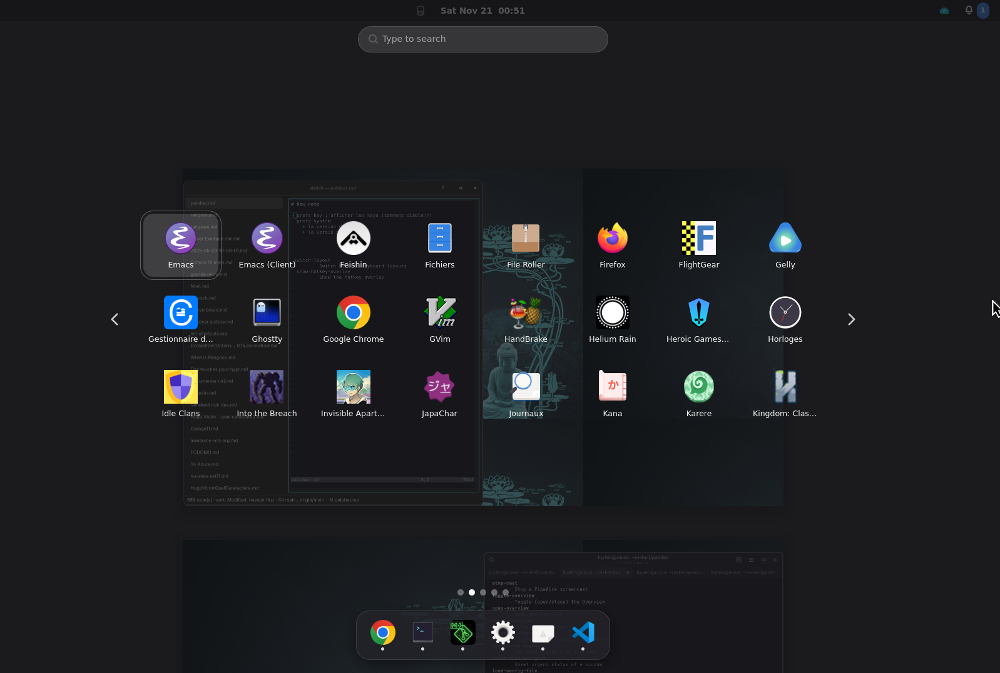

palobar is a cheap clone of GNOME visual style for niri

I am copying top bar

and partly its components

while in niri overview mode, typing triggers the launcher

and will gradually do some prefs

It is typescript and depends on ags astal.
The project is too young to describe installation which is likely a mess.

* `palobar` to run
* `palobar-prefs`
* `palobar-ctl quit`
* `palobar-ctl toggle-launcher`

See [TODO](TODO.md) for things i may add.
